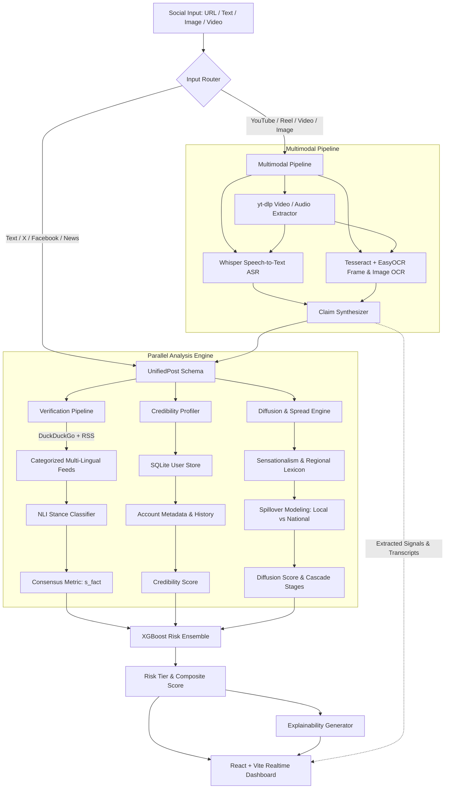

# 🛡️ SocialShield AI: Multimodal Misinformation Detection & Spillover Prediction

[](https://www.python.org/)
[](https://fastapi.tiangolo.com/)
[](https://react.dev/)
[](https://vitejs.dev/)
[](https://tailwindcss.com/)
[](https://xgboost.readthedocs.io/)
[](https://github.com/openai/whisper)
[](https://www.docker.com/)

> **v3.0.0** – Multimodal Edition

**SocialShield AI** is an end-to-end intelligence platform engineered to identify misinformation across social networks (**Instagram Reels/Posts, X/Twitter, Facebook, YouTube Videos & Shorts**) and predict its **diffusion trajectory** before it infiltrates **vulnerable local newsrooms, regional language portals, and mainstream broadcast channels**.

The system goes beyond reading text captions — it **sees the image**, **hears the audio**, and **reads every on-screen overlay** before running cross-source fact-verification.

---

## 📑 Table of Contents

- [Overview & Problem Statement](#-overview--problem-statement)
- [Key Capabilities](#-key-capabilities)
- [System Architecture](#-system-architecture)
- [Project Directory Structure](#-project-directory-structure)
- [Tech Stack](#-tech-stack)
- [Installation & Quickstart](#-installation--quickstart)
  - [Prerequisites](#prerequisites)
  - [Option A: Local Development](#option-a-local-development)
  - [Option B: Docker Compose](#option-b-docker-compose)
- [API Reference](#-api-reference)
- [Machine Learning & Evaluation](#-machine-learning--evaluation)
- [Configuration & News Feeds](#-configuration--news-feeds)
- [License](#-license)

---

## 🎯 Overview & Problem Statement

Viral rumors, unverified emergency warnings, and manufactured community panics (e.g., toxic water contamination, child-lifter scares, sudden currency demonetization) frequently originate on visual and microblogging platforms like Instagram, X, or private Facebook groups.

Traditional fact-checking systems only classify veracity retrospectively. **SocialShield AI** combines **cross-source natural language verification** with **epidemic diffusion modeling** to solve two critical questions:
1. **Is the claim factually supported or refuted by reputable global and regional sources?**
2. **How fast will this claim spread, and which local news desks or regional communities are in immediate danger of spillover?**

---

## ⚡ Key Capabilities

### 1. Multimodal Media Ingestion (`backend/multimodal/`)

> **New in v3.0.0**: The system no longer reads only captions. Every input goes through a full multimodal pipeline.

| Signal | Source | Module |
|---|---|---|
| **🎙️ Audio Speech** | YouTube videos, Instagram Reels, uploaded video clips | `transcriber.py` → Whisper / faster-whisper ASR |
| **🔍 On-Screen OCR Text** | Meme overlays, news chyrons, breaking banners, infographics | `ocr_engine.py` → Tesseract + EasyOCR |
| **🎬 Video Frame Analysis** | Key frames sampled at even intervals for banner detection | `transcriber.py` → frame sampler |
| **📺 YouTube Metadata** | Title, description, subtitles, channel, likes, views | `youtube_ingester.py` → yt-dlp |
| **📊 Unified Synthesis** | All above signals merged into one prioritized fact-check claim | `synthesizer.py` |

### 2. Multi-Platform Support
- **Instagram**: Captures reel/post URLs, captions, engagement ratios.
- **X (Twitter)**: Extracts status links, handle metadata, impressions, retweets, verification status.
- **Facebook**: Analyzes forwarded community alerts, neighborhood group posts.
- **YouTube** *(new)*: Full video/Short URL support — transcript, title, description, and frame OCR.
- **Web & News**: Accepts raw headlines, URLs, or free-form text claims.
- **Direct Upload**: Upload a screenshot, meme, infographic, or short video clip from your browser.

### 2. Multi-Language Categorized RSS Monitoring
- Live asynchronous scraping across **Indian English**, **Hindi (हिन्दी)**, **Malayalam (മലയാളം)**, **Tamil (தமிழ்)**, and **Global** news sources.
- Parallel thread-pool retrieval across 25+ trusted publishers (The Hindu, BBC, NDTV, Aaj Tak, Amar Ujala, 24 News, Thanthi TV, Reuters, Al Jazeera, etc.).

### 3. Source Consensus & NLI Stance Classification ($S_{fact}$)
- Automated source retrieval using DuckDuckGo (`ddgs`) and cached domain RSS feeds.
- Natural Language Inference (NLI) stance detection (**SUPPORTS**, **REFUTES**, **NEUTRAL**).
- Weighted credibility formula prioritizing authoritative national/international domains ($2.0\times$) over unverified web portals ($0.5\times$).

### 4. Author Credibility Profiling
- Calculates reliability scores ($0.0 - 1.0$) using account age, follower-to-engagement velocity, verified status, and historical accuracy.
- Persistent user history tracked in SQLite (`user_store.sqlite`).

### 5. Newsroom Spillover & Spread Velocity Forecasting
- **Social Virality Velocity**: Evaluates velocity multiplier based on platform dynamics, engagement rate, and sensational panic keywords.
- **Local Newsroom Vulnerability**: Identifies susceptibility of small regional tabloids, town WhatsApp networks, and district bureaus.
- **Mainstream Broadcast Spillover**: Forecasts likelihood of reaching national prime-time television.
- **Regional Affinity Detection**: Pinpoints high-risk geographies (Kerala, Tamil Nadu, Hindi Belt, Maharashtra, Karnataka).

### 6. XGBoost Risk Ensemble & Explainable AI (XAI)
- Gradient-boosted decision model assessing composite risk across veracity, credibility, diffusion, and sentiment subjectivity.
- Classifies into 4 actionable tiers: **Low**, **Medium**, **High**, **Critical**.
- Generates transparent, human-interpretable rationale for newsroom moderators and fact-checkers.

---

## 🏛️ System Architecture



---

## 📂 Project Directory Structure

```text
Misinformation-Spread/
├── backend/
│   ├── core/
│   │   ├── api.py              # FastAPI application & REST endpoints
│   │   ├── ensemble.py         # XGBoost multi-modal risk scoring
│   │   └── explainability.py   # Natural language explanation generator
│   ├── credibility/
│   │   ├── profiler.py         # Author credibility scoring logic
│   │   ├── roberta_classifier.py # RoBERTa domain classification
│   │   └── user_store.py       # SQLite database interface for account history
│   ├── data/
│   │   └── ingestion/
│   │       ├── mock_stream.py  # Synthetic post generator for testing
│   │       └── schema.py       # Pydantic UnifiedPost model
│   ├── diffusion/
│   │   └── predictor.py        # Spread velocity & newsroom spillover forecaster
│   ├── multimodal/             # 🎙️ Multimodal extraction engine
│   │   ├── ocr_engine.py       # Tesseract + EasyOCR image/frame text reader
│   │   ├── synthesizer.py      # Multi-signal fusion into unified claims
│   │   ├── transcriber.py      # Whisper speech-to-text audio engine
│   │   └── youtube_ingester.py # yt-dlp + youtube-transcript-api ingester
│   ├── verification/
│   │   ├── nli_classifier.py   # Natural language inference stance detection
│   │   ├── pipeline.py         # Weighted source consensus pipeline
│   │   └── retriever.py        # Multi-lingual RSS feeds & DuckDuckGo search
│   ├── benchmark.py            # Latency and concurrency stress tester
│   ├── Dockerfile              # Backend container definition
│   ├── evaluate.py             # XGBoost model training and ROC-AUC evaluation
│   ├── requirements.txt        # Python backend dependencies
│   └── train_roberta.py        # RoBERTa fine-tuning simulation on class-imbalanced data
├── frontend/
│   ├── public/                 # Static assets & icons
│   ├── src/
│   │   ├── components/
│   │   │   ├── AuthorProfile.jsx   # Author track record & metadata card
│   │   │   ├── MultimodalCard.jsx  # 🎙️ Whisper, OCR, and YouTube intelligence card
│   │   │   ├── RiskBadge.jsx       # Color-coded risk tier indicator
│   │   │   ├── SourceBreakdown.jsx # Fact-check sources, stance, and links
│   │   │   └── SpreadForecast.jsx  # Diffusion timeline, velocity & spillover charts
│   │   ├── App.css
│   │   ├── App.jsx             # Main interactive application & live news feed
│   │   ├── index.css           # TailwindCSS entry point
│   │   └── main.jsx            # React root mount
│   ├── package.json            # Frontend dependencies & scripts
│   ├── vite.config.js          # Vite configuration
│   └── tailwind.config.js      # Tailwind styling configuration
├── docker-compose.yml          # Container orchestration
├── .gitignore
└── README.md
```

---

## 💻 Tech Stack

| Layer | Technologies |
| :--- | :--- |
| **Frontend** | React 19, Vite 8, TailwindCSS v4, Vanilla JavaScript (ESM) |
| **Backend** | Python 3.10+, FastAPI, Uvicorn, Pydantic v2 |
| **Multimodal AI** | Whisper / Faster-Whisper (ASR), Tesseract OCR, EasyOCR, Pillow |
| **Media Extraction** | yt-dlp, youtube-transcript-api, OpenCV-compatible frame extractors |
| **Machine Learning / NLP** | XGBoost, PyTorch, Hugging Face Transformers (RoBERTa), Scikit-Learn |
| **Search & Ingestion** | DuckDuckGo Search (`ddgs`), Feedparser, BeautifulSoup4, HTTPX |
| **Storage** | SQLite (`user_store.sqlite`) |
| **Containerization** | Docker, Docker Compose |

---

## 🚀 Installation & Quickstart

### Prerequisites
- **Python**: Version `3.10` or higher
- **Node.js**: Version `18.0` or higher (with `npm`)
- **Git**

---

### Option A: Local Development

#### 1. Backend Setup
```bash
# Navigate to the backend directory
cd backend

# Create and activate a Python virtual environment
python -m venv venv

# On Windows (PowerShell):
.\venv\Scripts\Activate.ps1
# On macOS/Linux:
source venv/bin/activate

# Install required Python packages
pip install -r requirements.txt

# Start the FastAPI server (runs on http://localhost:8000)
python -m uvicorn core.api:app --reload --port 8000
```

> **API Documentation**: Once running, open [http://localhost:8000/docs](http://localhost:8000/docs) for interactive Swagger UI.

#### 2. Frontend Setup
```bash
# Open a new terminal and navigate to the frontend directory
cd frontend

# Install dependencies
npm install

# Start the Vite development server (runs on http://localhost:5173)
npm run dev
```

Open [http://localhost:5173](http://localhost:5173) in your browser to launch the interface.

---

### Option B: Docker Compose

You can spin up the backend service using Docker:

```bash
docker compose up --build
```

The backend API will be available at `http://localhost:8000`.

---

## 📡 API Reference

### 1. Fact-Check & Spread Analysis
- **Endpoint**: `POST /analyze`
- **Description**: Evaluates a social media post, URL, or claim text across verification, credibility, and diffusion models.
- **Request Body**:
```json
{
  "text": "Toxic chemical water supply contamination confirmed at district civil hospital ward 4.",
  "platform": "instagram",
  "author_username": "@city_residents_network",
  "likes": 4200,
  "shares": 1100,
  "views": 65000,
  "comments": 320,
  "followers": 24000,
  "verified": false
}
```
- **Response Sample**:
```json
{
  "credibility_score": 0.42,
  "verification": {
    "s_fact": 0.12,
    "analyzed_sources": [
      {
        "source": "The Hindu",
        "stance": "REFUTES",
        "credibility_weight": 2.0,
        "snippet": "Municipal corporation confirms water supply is completely safe..."
      }
    ]
  },
  "diffusion": {
    "score": 0.81,
    "velocity_multiplier": 2.4,
    "local_news_spillover_risk": "Very High (84%)",
    "mainstream_spillover_risk": "Moderate (42%)",
    "regional_affinity": "Kerala / Malayalam",
    "cascade_stages": [...]
  },
  "risk_assessment": {
    "risk_score": 0.86,
    "tier": "Critical"
  },
  "explanation": {
    "summary": "This claim has been flagged as CRITICAL risk due to low factual consensus...",
    "actionable_recommendations": [...]
  }
}
```

### 2. Live Regional & Global News Feed
- **Endpoint**: `GET /news`
- **Query Parameters**:
  - `limit` *(int, default: 60)*: Maximum headlines returned.
  - `category` *(optional)*: `Indian English`, `Hindi (हिन्दी)`, `Malayalam (മലയാളം)`, `Tamil (தமிழ்)`, or `Global`.
- **Response**: Returns latest live headlines grouped by outlet and category with direct "Fact-Check & Predict" triggers.

### 3. Multimodal Media Extraction (Images, Videos, YouTube)
- **Endpoint**: `POST /extract-media`
- **Supported Inputs**:
  - Multipart Form: file upload (image or video) with optional `url` or `caption` fields.
  - JSON Body: `{"url": "https://www.youtube.com/watch?v=...", "caption": "..."}`
- **Response**: Extracted OCR text, Whisper speech-to-text transcript, sensational overlays detected, platform metadata, and synthesized unified fact-check claim.

### 4. Social URL Extraction
- **Endpoint**: `GET /extract-social?url=<URL>` or `POST /extract-social`
- **Supported Platforms**: YouTube videos & Shorts, Instagram posts/reels, X / Twitter tweets, Facebook posts, and generic web articles.

### 5. Health Check
- **Endpoint**: `GET /health`
- **Response**: `{"status": "ok", "version": "3.0.0"}`

---

## 🧪 Machine Learning & Evaluation

The repository includes dedicated scripts to benchmark latency, train the ensemble, and test transformer pipelines:

### 1. Concurrency & Latency Benchmark
Tests server responsiveness under 100 concurrent asynchronous requests:
```bash
python backend/benchmark.py
```
*Goal: Validates sub-120ms response latency.*

### 2. XGBoost Ensemble Calibration
Evaluates classification performance across synthetic multi-modal distributions:
```bash
python backend/evaluate.py
```
*Outputs: Test Accuracy and ROC-AUC score.*

### 3. RoBERTa Domain Fine-Tuning Simulation
Demonstrates class-imbalance handling (85% credible vs 15% misinformation):
```bash
python backend/train_roberta.py
```
*Outputs: Comparative baseline vs RoBERTa F1-scores and accuracy.*

---

## 🌐 Configuration & News Feeds

News feeds and domain weights are configured in [`backend/verification/retriever.py`](backend/verification/retriever.py):
- **High-Trust Outlets ($2.0\times$)**: Reuters, BBC, The Hindu, Indian Express, NDTV, Aaj Tak, Amar Ujala, etc.
- **Categorized Feeds**: Easily extend `CATEGORIZED_FEEDS` to add regional languages or local district RSS feeds.
- **Sensational & Regional Lexicon**: Configured in [`backend/diffusion/predictor.py`](backend/diffusion/predictor.py) covering multilingual panic terms (Hindi, Malayalam, Tamil, English).

---

## 📄 License

This project is licensed under the MIT License. Feel free to use and adapt it for research, newsroom verification, and community safety applications.
